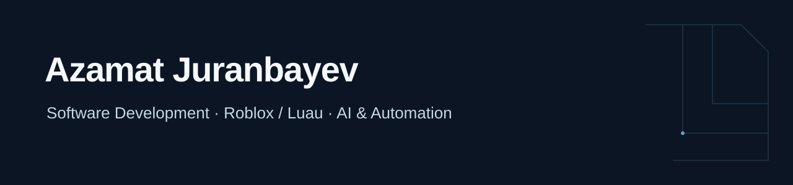

I’m **Azamat Juranbayev**, a software developer working with Roblox/Luau, AI integrations and automation. I’ve been freelancing since **2022** and study **Smart Security Technologies at Astana IT University**.

### Selected work

| Project | What I work on | Links |
| :--- | :--- | :--- |
| **Roblox portfolio** | Gameplay systems, weapons, movement, cameras and Discord-integrated application tools. | [Portfolio](https://sites.google.com/view/azalytical3715/main) |
| **NUCHO** | Beta platform for local events and communities in Astana and Almaty. | [Beta](https://nucho-web.nuchoapp.workers.dev/) |
| **Meridian Ops** | Personal demo for a fictional engineering company, connecting CRM, quotations, projects and service workflows with AI document search. | [Demo](https://meridian-ops-demo.azamatbreach.workers.dev/) |
| **Ascension** | Team captain and integrator for a city-planning hackathon app. Our team won the Astana Innovations special track at HackAlem AI. | [Demo](https://ascension-city-map.azamatbreach.workers.dev/) · [Team source](https://github.com/BAITC-Hacks/hack-0c0b9665-ascension) |

**Public code:** [Ascension SmartWalk](https://github.com/Azalytical/ascension-smartwalk), an urban RAG prototype.

### Stack

**Development:** Luau · Python · JavaScript · Node.js · .NET  
**AI and integration:** LLM APIs · RAG · MCP · HTTP/JSON  
**Data and infrastructure:** SQLite · Cloudflare Workers · Durable Objects · Git · Linux · Docker  
**Engineering:** IoT · ESP32 · STM32 · Raspberry Pi

[LinkedIn](https://www.linkedin.com/in/azamat-juranbayev-dev/) · [Roblox portfolio](https://sites.google.com/view/azalytical3715/main)
